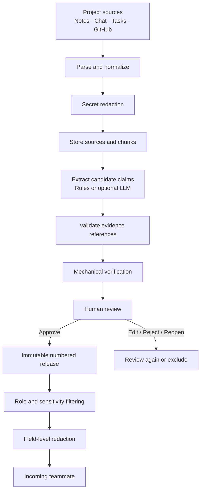

<div align="center">


# Handover

### Project knowledge that survives team changes.

**Turn scattered project context into evidence-backed, reviewable handovers.**

[](https://www.python.org/)
[](https://fastapi.tiangolo.com/)
[](https://www.postgresql.org/)
[](docs/09-testing.md)
[](LICENSE)

[Overview](#why-handover) · [Features](#what-it-does) · [Architecture](#how-it-works) · [Quick start](#quick-start) · [Documentation](#documentation)

<br />

<a href="https://render.com/deploy?repo=https://github.com/aayush-as69/Handover">
  
</a>

</div>

---

## Why Handover?

When a teammate leaves, their code may remain—but the context behind it often disappears.

Decisions live in meeting notes. Ownership is buried in task boards. Risks are scattered across conversations. Important details may exist only in someone's memory.

**Handover turns those scattered sources into a structured knowledge transfer.** It extracts candidate claims, links every claim to supporting evidence, checks that evidence mechanically, and requires human approval before information is published.

> Not another AI summary. A reviewable record of what the team knows, where it came from, and what still needs attention.

## What it does

<table>
<tr>
<td width="50%" valign="top">

### Evidence-first extraction
- Import notes, chat exports, task CSVs and public GitHub activity.
- Convert source material into addressable chunks.
- Attach evidence references to every extracted claim.
- Use deterministic rules or an optional OpenAI-compatible LLM.

</td>
<td width="50%" valign="top">

### Review before publication
- Inspect claims alongside their source evidence.
- Approve, edit, reject or reopen claims.
- Track immutable claim versions and review history.
- Publish approved claim versions as numbered releases.

</td>
</tr>
<tr>
<td width="50%" valign="top">

### Security and privacy
- Mask common secrets before source persistence.
- Enforce role and sensitivity rules on the server.
- Redact email addresses, phone numbers and restricted-role amounts.
- Keep confidential chunks out of remote LLM extraction by default.

</td>
<td width="50%" valign="top">

### Continuity insights
- Detect potential disagreements across sources.
- Generate “Questions Before I Leave” for missing context.
- Identify ownership, decision and risk gaps.
- Let incoming teammates acknowledge a specific release.

</td>
</tr>
</table>

## How it works



<details>
<summary><strong>Explore the knowledge pipeline</strong></summary>



</details>

### Confidence labels

| Label | What it tells you |
|---|---|
| **Quote-verified** | A supporting quote was found and passed mechanical support checks. It is not proof of semantic truth. |
| **Inferred** | Evidence exists, but the claim includes details not fully supported by the evidence. |
| **Conflicting** | Available evidence contradicts the claim. |
| **Unsupported** | No usable supporting quote was found. |

Verification and approval are separate. A person—not the model—decides whether a claim belongs in the published handover.

## Interface

The application uses server-rendered pages with a responsive bento-style layout, light/dark device preference, accessible focus states and reduced-motion support.

| Workflow | What to inspect |
|---|---|
| Review queue | Prioritized claims, confidence labels and filters |
| Claim detail | Supporting quotes, source links, review actions and version history |
| Conflicts | Potential disagreements across project sources |
| Questions | Missing ownership, decisions and unresolved context |
| Handover | Approved, role-filtered release content |
| Sources | Imported evidence and extraction actions |

> **Screenshots:** The repository currently contains architecture diagrams but no verified application screenshots. Add real captures to `docs/assets/screenshots/` after running the demo; do not treat mockups as product evidence.

## Tech stack

| Layer | Technology |
|---|---|
| Runtime | Python 3.12 |
| Web | FastAPI, Uvicorn, Jinja2 |
| Data | SQLAlchemy, SQLite, PostgreSQL |
| Validation | Pydantic |
| Migrations | Alembic |
| Extraction | Rule-based pipeline, optional OpenAI-compatible provider |
| Repository ingestion | GitHub REST API |
| Testing | Pytest, HTTPX, Playwright |
| Deployment configuration | Render |
| CI | GitHub Actions, SQLite, PostgreSQL 16, pip-audit |

## Quick start

### 1. Clone the repository

```bash
git clone https://github.com/aayush-as69/Handover.git
cd Handover
```

### 2. Create an environment

**Windows PowerShell**

```powershell
py -3.12 -m venv .venv
.\.venv\Scripts\Activate.ps1
```

**macOS / Linux**

```bash
python3.12 -m venv .venv
source .venv/bin/activate
```

### 3. Install dependencies

```bash
python -m pip install --upgrade pip
pip install -r requirements.lock -r requirements-dev.txt
```

### 4. Load the synthetic demo

```bash
python -m app.demo
python -m app.demo --extract rules
```

To set a password for demo accounts, define `DEMO_PASSWORD` before running the demo bootstrap.

### 5. Start the application

```bash
uvicorn app.main:app --reload
```

Open **http://127.0.0.1:8000/login**.

### Demo accounts

| Username | Role | Intended walkthrough |
|---|---|---|
| `riya` | Admin | Manage sources and extraction |
| `meera` | Approver | Review claims and sign off |
| `kabir` | Viewer | Read and acknowledge a release |
| `rao` | Restricted | Inspect reduced-clearance content |

The demo is synthetic. Configure `DEMO_PASSWORD` yourself; never reuse a production credential.

## Optional LLM extraction

Handover works with rule-based extraction without a provider key. To enable an OpenAI-compatible provider, configure:

```bash
LLM_BASE_URL=https://generativelanguage.googleapis.com/v1beta/openai
LLM_API_KEY=<your-key>
LLM_MODEL=<model-name>
```

Then run:

```bash
python -m app.demo --extract llm
```

Keep keys in environment variables or a secrets manager. Do not commit credentials. Confidential source chunks are withheld from remote extraction by default.

## Testing

Run the local suite:

```bash
python -m pytest -q
```

Run a focused test module:

```bash
python -m pytest -q tests/test_access.py
python -m pytest -q tests/test_verify.py
python -m pytest -q tests/test_ingest.py
```

For PostgreSQL testing, set `TEST_DATABASE_URL` to a test database before running pytest. See the [testing guide](docs/09-testing.md).

**Historical CI evidence:** the run recorded on 9 November 2026 reported 481 passing tests on SQLite and 482 on PostgreSQL 16, with no known vulnerabilities reported by `pip-audit`. This is a historical result, not a claim that the current checkout has just been tested.

## Documentation

The documentation is organized as a practical engineering guide.

| # | Guide | What it covers |
|---:|---|---|
| 01 | [Project overview](docs/01-project-overview.md) | Problem, users, workflows and scope |
| 02 | [Product requirements](docs/02-prd.md) | Requirements and acceptance criteria |
| 03 | [Software requirements](docs/03-srs.md) | Functional and non-functional requirements |
| 04 | [System architecture](docs/04-architecture.md) | Components, boundaries and data flows |
| 05 | [Database design](docs/05-database-design.md) | Entities, relationships and invariants |
| 06 | [Technical implementation](docs/06-technical-implementation.md) | Modules and processing pipelines |
| 07 | [Security architecture](docs/07-security.md) | Authentication, authorization and trust boundaries |
| 08 | [API and routes](docs/08-api-reference.md) | Browser, health and readiness routes |
| 09 | [Testing guide](docs/09-testing.md) | Test strategy and traceability |
| 10 | [Development setup](docs/10-development.md) | Environment and local workflow |
| 11 | [Deployment and operations](docs/11-deployment-operations.md) | Render, migrations, backup and recovery |
| 12 | [User and demo guide](docs/12-user-demo-guide.md) | Step-by-step product walkthrough |
| 13 | [Limitations and roadmap](docs/13-limitations-roadmap.md) | Known boundaries and proposed work |
| 14 | [Documentation audit](docs/14-documentation-coverage.md) | Coverage and verification checklist |

Additional references: [Features](docs/FEATURES.md) · [Operations](docs/OPERATIONS.md) · [Production readiness](docs/PRODUCTION_READINESS.md) · [Disclosures](docs/DISCLOSURES.md) · [Round 2 notes](docs/ROUND2.md).

## Repository map

```text
Handover/
├── app/
│   ├── extract/          # Rule and optional LLM extraction
│   ├── ingest/           # Parsers, GitHub collection and redaction
│   ├── templates/        # Server-rendered HTML
│   ├── static/           # Stylesheets and static assets
│   └── *.py              # Routes, domain logic, models and security
├── data/demo/            # Synthetic demonstration project
├── docs/                 # Product and engineering documentation
│   ├── assets/           # Logo and documentation visuals
│   ├── architecture.mmd  # Editable Mermaid source
│   └── architecture.svg  # Rendered architecture diagram
├── migrations/           # Alembic migration history
├── scripts/              # Operational helpers
├── tests/                # Unit, integration, security and browser tests
├── .github/workflows/    # CI workflow
├── render.yaml           # Render blueprint
└── requirements*.txt     # Runtime and development dependencies
```

## Security and limitations

Handover is designed with explicit trust boundaries, but it is not a guarantee of perfect data quality or secret detection.

- Mechanical verification checks textual evidence; it cannot establish truth, currentness or completeness.
- Secret detection and field redaction are pattern based and may miss unusual values or mask benign text.
- Conflict and question detection are rule based and require human judgment.
- Live LLM quality has not been verified in the documented CI baseline.
- Render configuration exists, but a live deployment has not been independently verified.
- Request throttling is process-local; use an edge/proxy rate limiter for production.
- The current deployment model assumes one project per deployment.

See [Security](docs/07-security.md) and [Limitations](docs/13-limitations-roadmap.md) before using real project data.

## Contributing

1. Read the [development guide](docs/10-development.md).
2. Keep access rules centralized and fail closed.
3. Treat source material and model output as untrusted input.
4. Add tests for behavior and security-sensitive changes.
5. Update relevant documentation when behavior changes.

## Acknowledgements

Built for the CodeFrontier hackathon (We Code Coders) by team **STARTEND**.

## License

Released under the [MIT License](LICENSE).

---

<div align="center">

**Handover — preserve the context behind the code.**

<sub>Made for teams that want their knowledge to outlast the handoff.</sub>

</div>
