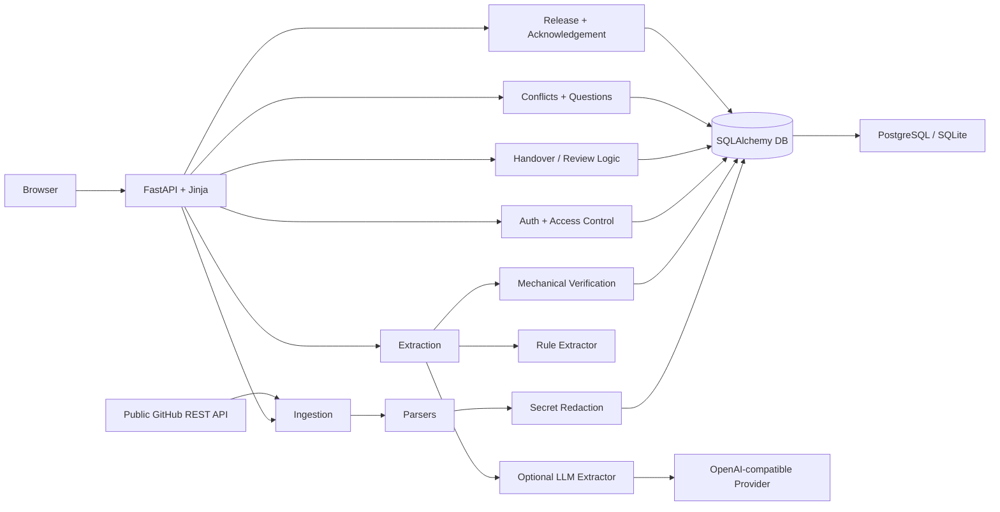

<div align="center">


# Handover

### When someone leaves, the reasons shouldn’t.

**Evidence-backed project knowledge transfer.** Turn scattered project context into reviewable handovers.

[](https://www.python.org/)
[](https://fastapi.tiangolo.com/)
[](https://www.postgresql.org/)
[](https://github.com/aayush-as69/Handover/actions/workflows/ci.yml)
[](LICENSE)

[Overview](#why-handover) · [Features](#what-it-does) · [Architecture](#how-it-works) · [Quick start](#quick-start) · [Documentation](#documentation)

<br />

<a href="https://render.com/deploy?repo=https://github.com/aayush-as69/Handover">
  
</a>

</div>

---

## Why Handover?

When a teammate leaves, their code may remain—but the context behind it often disappears.

Decisions live in meeting notes. Ownership is buried in task boards. Risks are scattered across conversations. Important details may exist only in someone's memory.

**Handover turns those scattered sources into a structured knowledge transfer.** It extracts candidate claims, links every claim to supporting evidence, checks that evidence mechanically, and requires human approval before information is published.

> Not another AI summary. A reviewable record of what the team knows, where it came from, and what still needs attention.

## What it does

<table>
<tr>
<td width="50%" valign="top">

### Evidence-first extraction
- Import notes, chat exports, task CSVs and public GitHub activity.
- Convert source material into addressable chunks.
- Attach evidence references to every extracted claim.
- Use deterministic rules or an optional OpenAI-compatible LLM.

</td>
<td width="50%" valign="top">

### Review before publication
- Inspect claims alongside their source evidence.
- Approve, edit, reject or reopen claims.
- Track immutable claim versions and review history.
- Publish approved claim versions as numbered releases.

</td>
</tr>
<tr>
<td width="50%" valign="top">

### Security and privacy
- Mask common secrets before source persistence.
- Enforce role and sensitivity rules on the server.
- Redact email addresses, phone numbers and restricted-role amounts.
- Keep confidential chunks out of remote LLM extraction by default.

</td>
<td width="50%" valign="top">

### Continuity insights
- Detect potential disagreements across sources.
- Generate “Questions Before I Leave” for missing context.
- Identify ownership, decision and risk gaps.
- Let incoming teammates acknowledge a specific release.

</td>
</tr>
</table>

## How it works



Source: [`docs/architecture.mmd`](docs/architecture.mmd).

### Confidence labels

| Label | What it tells you |
|---|---|
| **Quote-verified** | A supporting quote was found and passed mechanical support checks. It is not proof of semantic truth. |
| **Inferred** | Evidence exists, but the claim includes details not fully supported by the evidence. |
| **Conflicting** | Available evidence contradicts the claim. |
| **Unsupported** | No usable supporting quote was found. |

Verification and approval are separate. A person—not the model—decides whether a claim belongs in the published handover.

## Product preview

Handover keeps the important work in focused, role-aware screens.


The [screenshot gallery](docs/assets/screenshots/README.md) documents the remaining real application captures. The README stays selective; detailed walkthroughs belong in the guides.

## Workspace experience

- **Review queue:** risk-first ordering, status/confidence filters, pagination and keyword search.
- **Claim detail:** supporting quotes, verification notes, disputes, review actions and version history.
- **Conflicts:** inspect the claims behind a disagreement, record a resolution or reopen it.
- **Questions Before I Leave:** find unanswered context, inspect related claims, add an answer or dismiss a question.
- **Sources:** upload by file picker or drag and drop, classify sensitivity, run extraction and search ingested material.
- **Handover:** preview another role, jump between sections, search approved knowledge, publish a numbered release and acknowledge it.
- **Release history:** review sign-offs and acknowledgement counts.

The workspace uses responsive layouts, light/dark themes, readable typography and keyboard-visible focus states. Search and section navigation are client-side conveniences; authorization and data visibility remain enforced by the server.

## Tech stack

| Layer | Technology |
|---|---|
| Runtime | Python 3.12 |
| Web | FastAPI, Uvicorn, Jinja2 |
| Data | SQLAlchemy, SQLite, PostgreSQL |
| Validation | Pydantic |
| Migrations | Alembic |
| Extraction | Rule-based pipeline, optional OpenAI-compatible provider |
| Repository ingestion | GitHub REST API |
| Testing | Pytest, HTTPX, Playwright |
| Deployment configuration | Render |
| CI | GitHub Actions, SQLite, PostgreSQL 16, pip-audit |

## Quick start

### 1. Clone the repository

```bash
git clone https://github.com/aayush-as69/Handover.git
cd Handover
```

### 2. Create an environment

**Windows PowerShell**

```powershell
py -3.12 -m venv .venv
.\.venv\Scripts\Activate.ps1
```

**macOS / Linux**

```bash
python3.12 -m venv .venv
source .venv/bin/activate
```

### 3. Install dependencies

```bash
python -m pip install --upgrade pip
pip install -r requirements.lock -r requirements-dev.txt
```

### 4. Configure demo access

For a local demo, set both variables in the same terminal session before starting the app. The app will create the synthetic project and demo users on startup.

**macOS / Linux**
```bash
export DEMO_MODE=1
export DEMO_PASSWORD=handover123
```

**Windows PowerShell**
```powershell
$env:DEMO_MODE = "1"
$env:DEMO_PASSWORD = "handover123"
```

When `DEMO_MODE` and `DEMO_PASSWORD` are configured, the login page passes the configured demo password to the demo-account selector so a click fills both fields. The value is visible to anyone using that public demo, so use it only with synthetic demo accounts. Never reuse a production credential.

### 5. Start the application

```bash
uvicorn app.main:app --reload
```

Open **http://127.0.0.1:8000/login**.

### Demo accounts

| Username | Role | Intended walkthrough |
|---|---|---|
| `riya` | Admin | Manage sources and extraction |
| `meera` | Approver | Review claims and sign off |
| `kabir` | Viewer | Read and acknowledge a release |
| `rao` | Restricted | Inspect reduced-clearance content |

The demo is synthetic. When `DEMO_MODE=1` and `DEMO_PASSWORD=handover123` are configured, clicking Meera, Riya, Kabir or Mr. Rao fills that member's username and the shared demo password; the visitor still presses Sign in. The password is supplied by the deployment configuration and is visible to users of the public demo. It must only be used for synthetic demo accounts, never production.

## Optional LLM extraction

Handover works with rule-based extraction without a provider key. To enable an OpenAI-compatible provider, configure:

```bash
LLM_BASE_URL=https://generativelanguage.googleapis.com/v1beta/openai
LLM_API_KEY=<your-key>
LLM_MODEL=<model-name>
```

Then run:

```bash
python -m app.demo --extract llm
```

Keep keys in environment variables or a secrets manager. Do not commit credentials. Confidential source chunks are withheld from remote extraction by default.

## Testing

Run the local suite:

```bash
python -m pytest -q
```

Run the browser walkthrough tests after installing Playwright and Chromium:

```bash
python -m playwright install chromium
python -m pytest -q tests/test_browser_e2e.py
```

For PostgreSQL testing, set `TEST_DATABASE_URL` to a disposable test database before running pytest.

GitHub Actions runs tests on SQLite and PostgreSQL 16, then audits locked runtime dependencies with `pip-audit`. See the [testing guide](docs/09-testing.md) and [CI workflow](.github/workflows/ci.yml) for the exact checks and current results.

## Documentation

Detailed guides live in [`docs/`](docs/README.md).

- **Product:** [Overview](docs/01-project-overview.md) · [Product requirements](docs/02-prd.md) · [Software requirements](docs/03-srs.md) · [User and demo guide](docs/12-user-demo-guide.md) · [Features](docs/FEATURES.md)
- **Engineering:** [Architecture](docs/04-architecture.md) · [Database design](docs/05-database-design.md) · [Implementation](docs/06-technical-implementation.md) · [Security](docs/07-security.md) · [API and routes](docs/08-api-reference.md) · [Testing](docs/09-testing.md) · [Development setup](docs/10-development.md)
- **Operations:** [Deployment and operations](docs/11-deployment-operations.md) · [Production readiness](docs/PRODUCTION_READINESS.md) · [Limitations and roadmap](docs/13-limitations-roadmap.md) · [Disclosures](docs/DISCLOSURES.md)

## Repository map

```text
Handover/
├── app/
│   ├── extract/          # Rule and optional LLM extraction
│   ├── ingest/           # Parsers, GitHub collection and redaction
│   ├── templates/        # Server-rendered HTML
│   ├── static/           # Stylesheets and static assets
│   └── *.py              # Routes, domain logic, models and security
├── data/demo/            # Synthetic demonstration project
├── docs/                 # Product and engineering documentation
│   ├── assets/           # Logo and documentation visuals
│   └── architecture.mmd  # Mermaid architecture diagram
├── migrations/           # Alembic migration history
├── scripts/              # Operational helpers
├── tests/                # Unit, integration, security and browser tests
├── .github/workflows/    # CI workflow
├── render.yaml           # Render blueprint
└── requirements*.txt     # Runtime and development dependencies
```

## Security and limitations

Handover is designed with explicit trust boundaries, but it is not a guarantee of perfect data quality or secret detection.

- Mechanical verification checks textual evidence; it cannot establish truth, currentness or completeness.
- Secret detection and field redaction are pattern based and may miss unusual values or mask benign text.
- Conflict and question detection are rule based and require human judgment.
- Live LLM quality has not been verified in the documented CI baseline.
- Render configuration exists, but a live deployment has not been independently verified.
- Request throttling is process-local; use an edge/proxy rate limiter for production.
- The current deployment model assumes one project per deployment.

See [Security](docs/07-security.md) and [Limitations](docs/13-limitations-roadmap.md) before using real project data.

## Contributing

1. Read the [development guide](docs/10-development.md).
2. Keep access rules centralized and fail closed.
3. Treat source material and model output as untrusted input.
4. Add tests for behavior and security-sensitive changes.
5. Update relevant documentation when behavior changes.

## Acknowledgements

Built for the CodeFrontier hackathon (We Code Coders) by team **STARTEND**.

## License

Released under the [MIT License](LICENSE).

---

<div align="center">

**Handover — preserve the context behind the code.**

<sub>Made for teams that want their knowledge to outlast the handoff.</sub>

</div>
