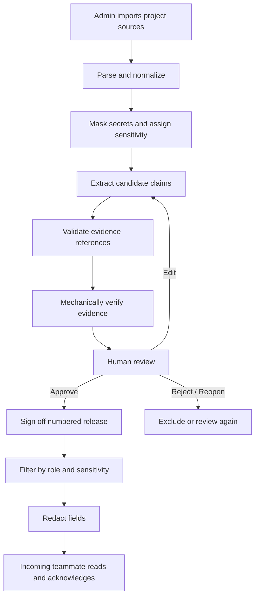

# 01 — Project Overview

*The context behind a project should survive the people who built it.*

## At a glance

| Attribute | Description |
|---|---|
| Product | Handover |
| Category | Evidence-backed project knowledge transfer |
| Primary users | Admins, approvers, incoming teammates and restricted readers |
| Application | FastAPI with server-rendered Jinja pages |
| Persistence | SQLite for local use; PostgreSQL supported |
| Core principle | Evidence first, human approval before publication |

## 1. Purpose

Handover is a knowledge-transfer application for projects where important context can be lost when a team member leaves.

It ingests project evidence, extracts candidate claims, checks those claims against their sources, routes them through human review, and publishes approved information to role-appropriate readers.

The **claim plus its evidence** is the central unit of knowledge—not an opaque AI-generated summary.

## 2. The problem

Project knowledge is distributed across meeting notes, team chat, task exports and repository activity. A replacement teammate needs more than files: they need to know why a decision was made, who owns unfinished work, which risks remain, and what information is sensitive.

Without a structured handover, that context must be reconstructed manually.

## 3. Target users

| Role | Responsibility |
|---|---|
| `admin` | Manage sources and project-level operations; full clearance |
| `approver` | Inspect evidence, review claims and sign off releases |
| `viewer` | Read and acknowledge an approved handover |
| `restricted` | Read a reduced-clearance version of the handover |

Roles and clearance mappings are defined in `app/enums.py` and enforced through `app/access.py`.

## 4. End-to-end workflow

1. An admin imports project sources.
2. Parsers convert source content into addressable chunks.
3. Secret masking runs before chunks are persisted.
4. An extractor creates candidate claims and evidence references.
5. Verification assigns a mechanical confidence label.
6. Reviewers inspect, approve, edit, reject or reopen claims.
7. Approved claim versions can be signed off into a numbered release.
8. Readers see only information permitted by their role and effective sensitivity.
9. Readers can acknowledge a specific release.

## 5. Product differentiators

- **Evidence-linked claims:** reviewers can inspect the source behind a statement.
- **Separate verification and approval:** model output cannot approve its own claims.
- **Sensitivity propagation:** claim visibility accounts for its supporting evidence.
- **Server-side authorization:** the browser never decides what a user is allowed to see.
- **Field-level redaction:** selected personal/contact and monetary fields are hidden by role.
- **Immutable history:** claim versions and published releases preserve what was reviewed.
- **Stale-release protection:** changes to released claims prevent non-reviewers from relying on an outdated handover.

## 6. Functional scope

### Included in the repository

- Notes, chat, task CSV and public GitHub source ingestion.
- Rule-based extraction and optional OpenAI-compatible LLM extraction.
- Evidence verification, human review and claim history.
- Conflict detection and Questions Before I Leave.
- Role-filtered handover releases and acknowledgements.
- SQLite/PostgreSQL persistence and Alembic migrations.
- Security controls, operational helpers and CI.

### Not currently built

- Multiple projects per deployment.
- Dedicated audit-log UI.
- Named acknowledgement history UI.
- Richer conflict visualization.
- Extraction-quality reporting.
- Stronger semantic evaluation.

These are roadmap items, not delivered features.

## 7. Non-functional design goals

The implementation addresses:

- fail-closed authorization and CSRF protection;
- persistent login-failure tracking and request throttling;
- secret masking before source persistence;
- production configuration validation and secure cookies;
- append-only history for critical records;
- optimistic locking for claim edits;
- duplicate/race-safe creation for selected records;
- liveness and readiness checks;
- CI against SQLite and PostgreSQL.

See [System Architecture](04-architecture.md), [Security](07-security.md), and [Limitations](13-limitations-roadmap.md).
