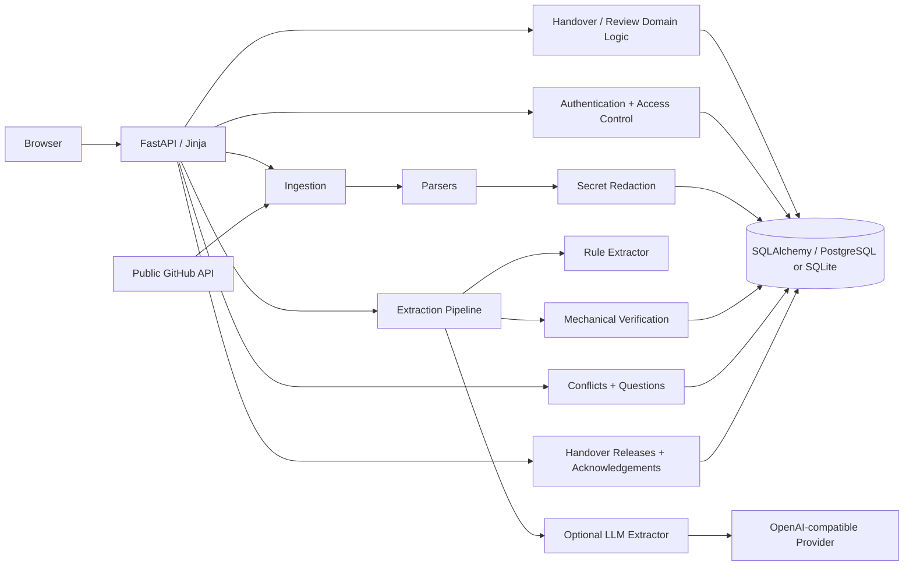

# 04 — System Architecture

## 1. High-level architecture

Handover is a single FastAPI application with server-rendered Jinja pages, SQLAlchemy persistence, Alembic migrations and an optional remote LLM integration.



Editable source: [architecture.mmd](architecture.mmd).

## 2. Request lifecycle

1. Browser sends request.
2. Rate limiting middleware checks the caller address except health/readiness/static paths.
3. Security-header middleware wraps the response.
4. Session middleware resolves signed session state.
5. Route dependency resolves the current user when required.
6. Server-side role/clearance checks run.
7. Route reads/writes through SQLAlchemy.
8. State-changing forms require a CSRF token.
9. Response is rendered with Jinja or returned as JSON for health/readiness.

## 3. Ingestion lifecycle

```text
Upload / GitHub
      │
      ▼
Validate size/type
      │
      ▼
Parse completely
      │
      ▼
SHA-256 content hash
      │
      ├── duplicate ──► return existing source
      │
      ▼
Secret redaction
      │
      ▼
Sensitivity propagation
      │
      ▼
Persist Source + Chunks
```

The implementation intentionally parses before database writes so a malformed source does not leave a half-ingested record.

## 4. Extraction lifecycle

```text
Chunks
  │
  ├── local rules ───────────────┐
  │                              │
  └── optional remote LLM ───────┤
                                 ▼
                        ExtractedClaim schema
                                 │
                    evidence chunk-id validation
                                 │
                    duplicate claim detection
                                 │
                        mechanical verification
                                 ▼
                         Draft Claim records
```

Remote extractors are prevented from receiving confidential chunks by default.

## 5. Publication lifecycle

```text
Generated / Edited
        │
        ▼
   Human review
   ┌────┼─────┐
approve edit reject
   │     │     │
   │     └──► re-verify + review again
   ▼
Approved claims
        │
        ▼
Numbered immutable release
        │
        ▼
Role + sensitivity filtering
        │
        ▼
Field-level redaction
        │
        ▼
Reader / acknowledgement
```

If a released claim is subsequently edited, rejected or reopened, the release becomes stale for non-reviewers until a new release is signed off.

## 6. Architectural boundaries

| Boundary | Rule |
|---|---|
| Browser → server | Browser never determines authorization |
| Source → database | Secrets masked before storage |
| Source → LLM | Confidential chunks withheld by default |
| LLM → claim store | Pydantic validation + evidence validation |
| Verification → approval | Verification cannot approve |
| Claim → reader | Effective sensitivity and role clearance |
| Release → history | Release records are append-only |
