<div align="center">


# 04 — System Architecture

*One application, explicit trust boundaries, evidence through every stage.*

</div>

## 1. Architecture overview

Handover is a FastAPI application with server-rendered Jinja pages, SQLAlchemy persistence, Alembic migrations and an optional remote LLM integration.



[View the editable Mermaid source](architecture.mmd) · [Open PNG diagram](architecture.png)

## 2. Component responsibilities

| Component | Responsibility |
|---|---|
| FastAPI and Jinja | Browser routes, forms and server-rendered pages |
| Authentication | Session resolution, login and logout |
| Access control | Role clearance and effective sensitivity checks |
| Ingestion | Source validation, parsing, hashing and deduplication |
| Redaction | Mask secrets before source persistence and external submission |
| Extraction | Rule-based and optional LLM claim generation |
| Verification | Mechanical evidence checks and confidence labels |
| Review | Human approval, editing, rejection and reopening |
| Conflicts and questions | Highlight disagreements and missing context |
| Handover | Versioned release creation, filtering and acknowledgement |
| SQLAlchemy | Persistence to SQLite or PostgreSQL |

## 3. Request lifecycle

1. The browser sends a request.
2. Rate-limiting middleware checks the caller address, with health/readiness/static exclusions.
3. Security-header middleware wraps the response.
4. Session middleware resolves signed session state.
5. Route dependencies resolve the current user where authentication is required.
6. Server-side role and clearance checks run.
7. SQLAlchemy reads or writes the required records.
8. State-changing forms require a CSRF token.
9. The application renders a page or returns health/readiness JSON.

The browser is not an authorization boundary.

## 4. Ingestion lifecycle

```text
Upload / public GitHub source
              │
              ▼
       Validate size/type
              │
              ▼
          Parse fully
              │
              ▼
       SHA-256 content hash
              │
        ┌─────┴─────┐
        │           │
     Duplicate    New source
        │           │
  Return existing  Redact secrets
                    │
             Assign sensitivity
                    │
             Store source/chunks
```

The service parses a complete source before creating database records. This avoids leaving a partially ingested source after a parsing failure.

## 5. Extraction and verification

```text
                       Source chunks
                            │
               ┌────────────┴────────────┐
               │                         │
          Rule extractor          Optional LLM
               │                         │
               └────────────┬────────────┘
                            ▼
                  Validate claim schema
                            │
                 Validate evidence IDs
                            │
                   Detect duplicates
                            │
                 Mechanical verification
                            │
                            ▼
                      Draft claims
```

Remote extraction excludes confidential chunks by default. The extractor treats source material as untrusted data, validates output against strict schemas, and rejects invalid evidence references.

## 6. Publication lifecycle

```text
Draft claim
    │
    ▼
Human review ────────┬───────────┐
    │                │           │
  Approve           Edit       Reject
    │                │           │
    │          Re-verify       Exclude
    │          Review again
    ▼
Numbered immutable release
    │
    ▼
Role + sensitivity filtering
    │
    ▼
Field-level redaction
    │
    ▼
Reader / acknowledgement
```

A later edit, rejection or reopening can make an earlier release stale for non-reviewers until a new release is signed off.

## 7. Trust boundaries

| Boundary | Enforced rule |
|---|---|
| Browser → server | Authorization is evaluated server-side |
| Source → database | Secrets are masked before persistence |
| Source → remote LLM | Confidential chunks withheld by default |
| LLM → claim store | Schema and evidence references validated |
| Verification → approval | Verification cannot approve a claim |
| Claim → reader | Effective sensitivity and role clearance apply |
| Release → history | Published release records are append-only |

## 8. Runtime and deployment

- Local development and tests can use SQLite.
- PostgreSQL is supported for production deployment.
- Alembic manages schema migrations.
- Render configuration is provided in `render.yaml`.
- `/health` reports liveness; `/ready` checks database connectivity and migration state.

See [Database Design](05-database-design.md), [Security](07-security.md), and [Deployment & Operations](11-deployment-operations.md).
