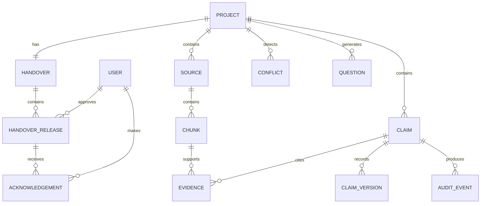

<div align="center">


# 05 — Database Design

<sub>Handover · Product requirements and engineering reference</sub>

</div>

> [Documentation index](README.md) · [Project home](../README.md)

---

## 1. Database technology

SQLAlchemy is the persistence layer. PostgreSQL is the production/deployment target; SQLite is used for local development and tests.

Alembic owns migration history. The current repository contains an initial migration and explicit handling for databases created before migration history existed.

## 2. Entities

### User

Stores login identity and role.

Key fields: `id`, `username` (unique), `display_name`, `role`, `password_hash`.

### Project

Represents the project being handed over.

Key fields: `id`, `name`, `description`, `outgoing_member`, `created_at`.

Relationships: one project has many sources and claims.

### Source

Represents an ingested project source.

Key fields: `project_id`, `kind`, `name`, `origin`, `sensitivity`, `content_hash`, `ingested_at`.

Constraint: `(project_id, content_hash)` is unique.

### Chunk

An addressable piece of source text.

Key fields: `source_id`, `idx`, `text`, `locator`, `author`, `occurred_at`, `sensitivity`, `redacted`.

Constraint: `(source_id, idx)` is unique.

### Claim

The central knowledge unit.

Key fields include statement, type, topic/value, owner, confidence, sensitivity, review status, version, extractor, verification note and semantic advisory fields.

A claim has evidence, versions and audit events.

### Evidence

Connects a claim to a source chunk and stores the exact snippet used as evidence.

The stored evidence content is guarded against later modification/deletion.

### ClaimVersion

Append-only snapshot of claim state after each recorded change.

Constraint: `(claim_id, version)` is unique.

### Handover

One handover per project.

Constraint: `project_id` is unique.

### HandoverRelease

Immutable sign-off snapshot represented as claim/version pairs.

Constraint: `(handover_id, number)` is unique.

### Acknowledgement

Records that one user acknowledged one release.

Constraint: `(release_id, user_id)` is unique.

### Conflict

Represents a mechanically detected disagreement between claims.

Constraint: `(project_id, key)` is unique.

### Question

Represents a generated “Questions Before I Leave” gap.

Constraint: `(project_id, key)` is unique.

### AuditEvent

Append-only record of verification and related claim events.

### LoginAttempt

Persistent failed-login evidence used for throttling/lockout across restarts and workers.

## 3. Relationship model



## 4. Integrity model

Critical historical rows are protected by SQLAlchemy event guards:

- `ClaimVersion` cannot be updated/deleted.
- `AuditEvent` cannot be updated/deleted.
- `HandoverRelease` cannot be updated/deleted.
- `Evidence` content/identity cannot be changed and evidence cannot be deleted.

Claim optimistic locking uses the `version` field so concurrent updates do not silently overwrite a newer version.

## 5. Migration lifecycle

Normal upgrade:

```bash
python -m app.db upgrade
```

Check status:

```bash
python -m app.db status
```

For an old pre-Alembic database, the repository provides `adopt` and `adopt --dry-run`. It refuses unsafe schema differences instead of guessing.

Downgrade requires explicit confirmation:

```bash
python -m app.db downgrade <revision> --yes
```

Back up first because downgraded schema objects/data may be lost.


---

[← Documentation index](README.md) · [Project home](../README.md)
