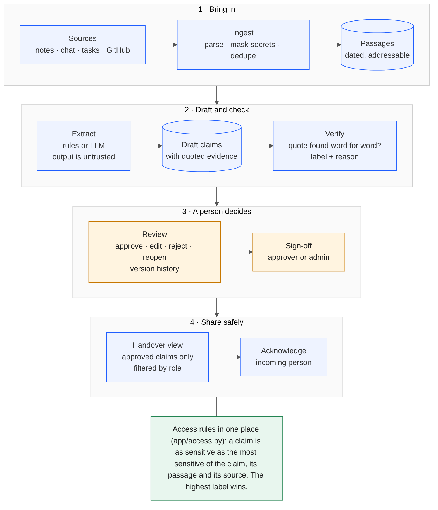

# Handover: Round 2 build document

Team STARTEND (solo) · CodeFrontier, We Code Coders · Repository: https://github.com/aayush-as69/Handover

## 1. What was built
Handover turns scattered project activity into a reviewed handover for the person taking
over. Every claim carries its evidence (quoted from the source), a confidence label with a
reason, and a sensitivity label. A person approves the handover before anyone reads it, and
each reader sees only what their role allows.

Working end to end in the demo:
1. Admin uploads meeting notes, chat, a task CSV or GitHub data (or the demo loads them).
2. Secrets are masked before storage; sources are split into dated, addressable passages.
3. An extractor drafts claims, each pointing at exact quotes.
4. A verification pass checks every quote against its source and labels each claim.
5. An approver reviews each claim beside its evidence: approve, edit, reject or reopen.
6. An approver signs off the handover. Each role then sees its own filtered view, and the
   incoming person acknowledges it.

## 2. Architecture

Source of the diagram: `docs/architecture.mmd` (Mermaid).
| Layer | Module | Job |
|---|---|---|
| Data model | `app/models.py`, `enums.py` | Claim, evidence, versions, sources, chunks, handover, acknowledgement |
| Access rules | `app/access.py` | One place that decides who may see what; the UI never decides |
| Ingestion | `app/ingest/` | Parsers, secret masking, dedupe, public GitHub reader |
| Extraction | `app/extract/` | Rule-based extractor, OpenAI-compatible LLM extractor, pipeline that validates output |
| Verification | `app/verify.py` | Word-for-word quote check, key-term/number/negation checks |
| Handover | `app/handover.py` | Sign-off, role-filtered sections, acknowledgement |
| Web | `app/web.py`, `handover_web.py`, `security.py`, templates | Login, review, handover and source pages |

## 3. Trust rules, enforced in code and tested
- Claims start `unsupported` until verified; labels come from mechanical checks, never from a
  model's opinion. An invented or paraphrased quote is caught.
- Effective sensitivity is the highest of the claim, its evidence passages and their sources.
- Confidential passages are never sent to a remote model unless explicitly allowed.
- Model output is untrusted: evidence must point at a passage the model was given.
- Nothing is approved automatically. Approving a not-fully-verified claim needs a written reason.
- A sign-off is an immutable numbered release. Editing, rejecting or reopening a signed-off claim makes the release stale, so non-reviewers see nothing until it is signed again.
- Login: salted PBKDF2 hashes, lockout after repeated failures, CSRF tokens on every form,
  signed session cookies, security headers, output escaping.

## 4. Libraries, services and AI use
FastAPI, Uvicorn, SQLAlchemy, Pydantic, Jinja2, python-multipart, HTTPX, itsdangerous,
psycopg, alembic, pytest (tests: playwright, pip-audit). Services: GitHub public REST API (read only), Render (hosting + PostgreSQL),
and an optional OpenAI-compatible LLM chosen by the operator. Claude was used as a coding
assistant; see `docs/DISCLOSURES.md`. All demo data is synthetic.

## 5. Changes from the Round 1 plan
| Round 1 | Round 2 | Why |
|---|---|---|
| React front end | Server-rendered pages (Jinja2, no JavaScript) | Solo build; smaller attack surface; every access check stays on the server |
| LLM-led extraction | Rule-based extractor plus an LLM extractor behind one interface | No API key was available at build time; the rule-based path works offline and is fully tested |
| Conflict detection, gap checklist, redaction views | Built (see `FEATURES.md`) | Planned in Round 1; delivered after the first draft of this document |

## 6. Testing evidence
`pytest`: 182 tests passed when this document was first drafted. In the GitHub Actions run of 9 Nov 2026 (commit `100ed36`) 354 passed on SQLite and 354 on PostgreSQL 16, including a real-browser walkthrough. They cover the data model, access rules, demo data, ingestion, extraction,
verification, login, review actions, handover views, uploads and a full walkthrough from boot
to acknowledgement. Each trust rule was also checked by mutation: the rule was deliberately
broken in a scratch copy and the tests had to fail (for example, removing the CSRF check, the
role check, the clearance check or the handover sign-off check). Survivors were fixed by
adding a test.

## 7. Known limitations (stated plainly)
- The LLM extractor is tested against simulated provider responses only. Its quality on a
  live model has not been measured. Demo claims come from the rule-based extractor.
- The rule-based extractor reads structure only; it cannot read chat or spot cross-source conflicts.
- Verification is a coarse text check. It cannot judge meaning, which is why a human approves every claim.
- Secret masking is pattern based and may miss unusual formats.
- Login lockout is stored in the database, per username and per client address.
- Sign-offs are immutable numbered releases; editing a signed-off claim makes the release stale until re-signed.
- The free hosting tier sleeps when idle and its free database may expire; the first request can be slow.

## 8. Additional features (built, see `FEATURES.md`)
1. Cross-source conflict detection: group claims by topic and value, flag disagreements between sources.
2. "Questions Before I Leave": a checklist of missing owners, reasons and open items for the leaver.
3. Redaction and multiple role views: field-level redaction inside a claim, with per-role previews.

## 9. How to run
See `README.md`. Hosted demo: deploy `render.yaml`, set `DEMO_PASSWORD` in the dashboard, then sign in as
`meera` (approver), `riya` (admin), `kabir` (viewer) or `rao` (restricted).
