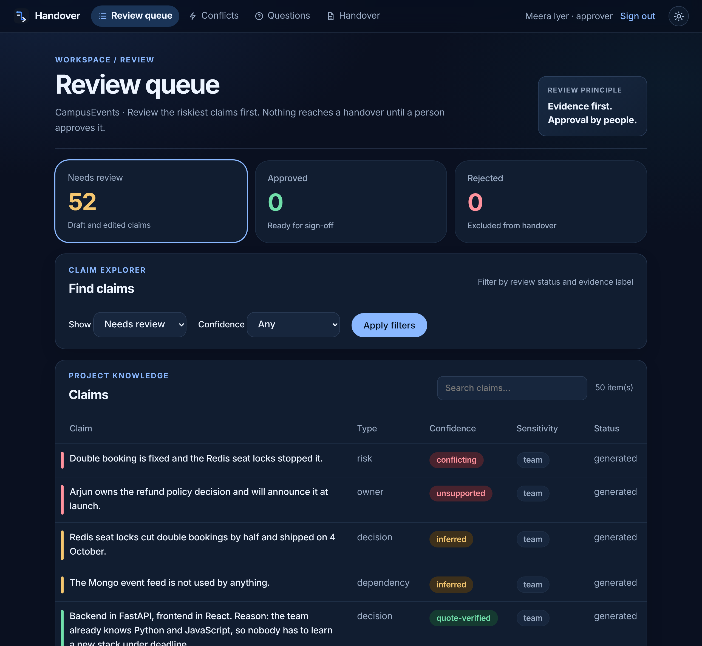
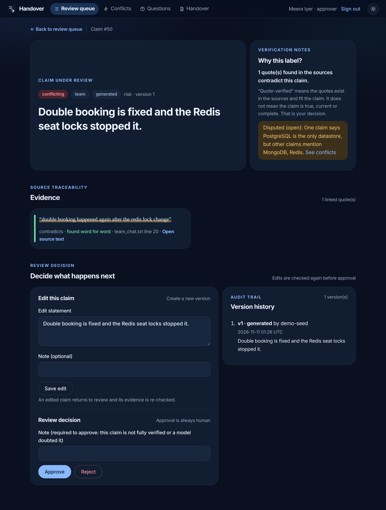
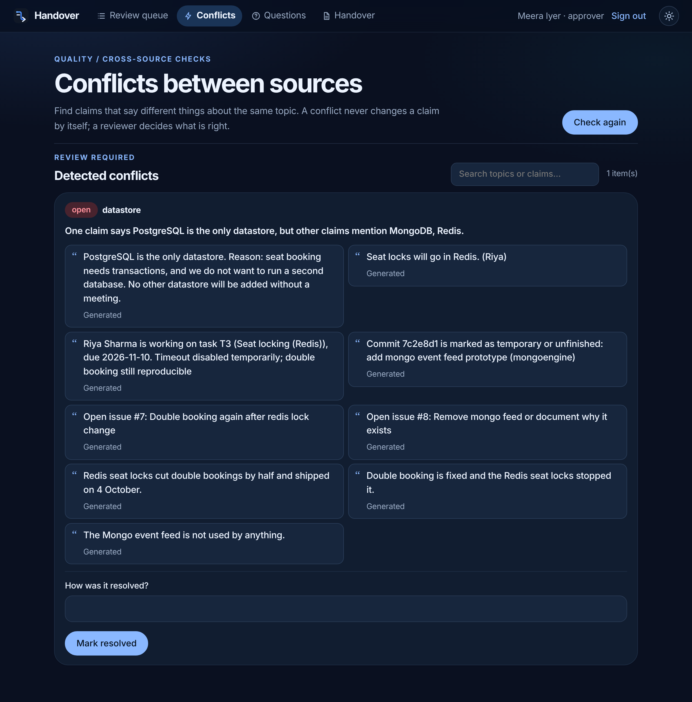
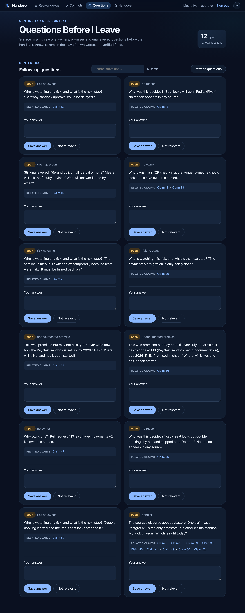
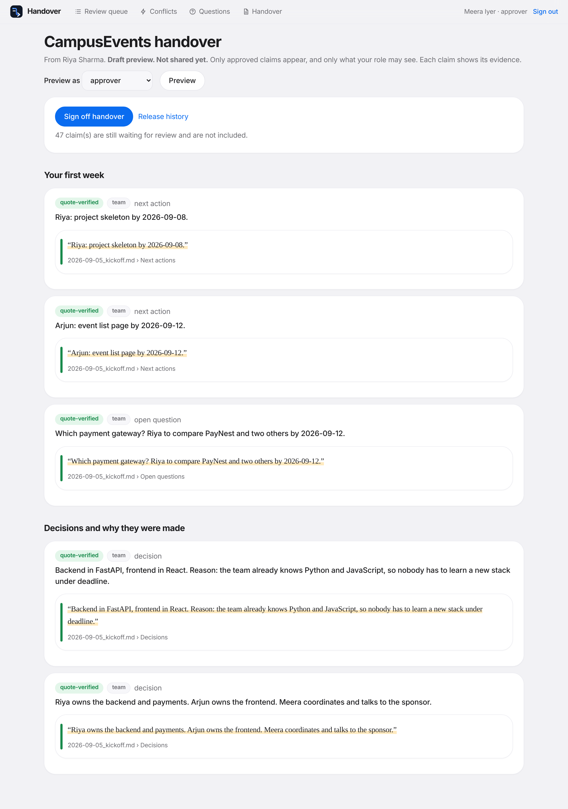
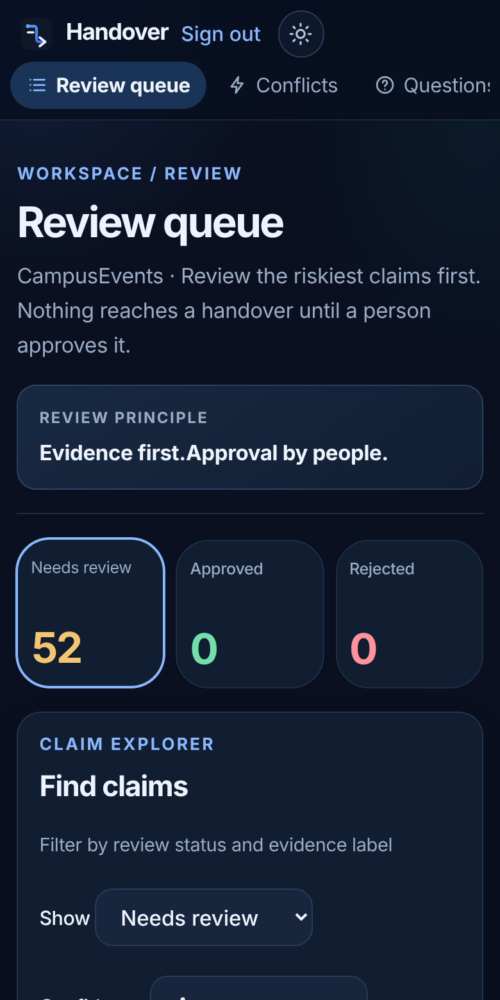

# Screenshot gallery

Real captures of the running application, taken from the synthetic demo as the reviewer `meera`. The two most useful ones are also in the [main README](../../../README.md).

## Review queue
Claims riskiest first, with confidence labels, counts and filters. The demo includes four deliberately weak draft claims so every label appears.

## Claim verification
The exact quote beside the claim, the reason for its label, the decision form and the version history.

## Conflicts
Where sources disagree.

## Questions Before I Leave
Gaps in ownership, reasons and open decisions for the outgoing person to answer.

## Handover preview
Approved claims only, each with its quote. This capture was taken after approving five quote-verified claims in a local copy of the demo.

## On a phone
The grid folds to one column and the claim table becomes stacked cards.

---

To retake these, run the demo locally, sign in as `meera`, and capture at about 1280 × 860. Keep passwords and environment values out of view, and use real captures, not mockups.
